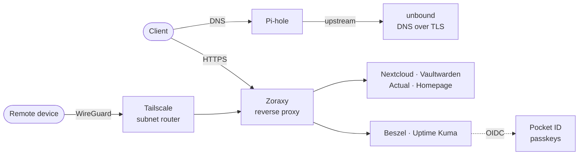

<div align="center">


# homelab

Self-hosted services on a single Raspberry Pi, run with Docker Compose.

</div>

## Overview



- Every service has its own hostname under a local domain. Pi-hole resolves the wildcard to the reverse proxy, and Zoraxy terminates TLS.
- Services sit on a shared Docker network behind the proxy and do not publish ports unless they have to.
- Pocket ID provides passkey sign-in over OIDC.

## Tech stack

<table>
  <tr><th></th><th>Name</th><th>Role</th></tr>
  <tr><td></td><td><a href="https://docs.docker.com/compose/">Docker Compose</a></td><td>One stack per service</td></tr>
  <tr><td></td><td><a href="https://github.com/tobychui/zoraxy">Zoraxy</a></td><td>Reverse proxy and TLS</td></tr>
  <tr><td></td><td><a href="https://pi-hole.net">Pi-hole</a></td><td>DNS and ad blocking</td></tr>
  <tr><td></td><td><a href="https://nlnetlabs.nl/projects/unbound/">unbound</a></td><td>Upstream resolver, DNS over TLS</td></tr>
  <tr><td></td><td><a href="https://tailscale.com">Tailscale</a></td><td>Remote access</td></tr>
  <tr><td></td><td><a href="https://github.com/pocket-id/pocket-id">Pocket ID</a></td><td>OIDC provider with passkeys</td></tr>
  <tr><td></td><td><a href="https://nextcloud.com">Nextcloud</a></td><td>Files, with MariaDB and Redis</td></tr>
  <tr><td></td><td><a href="https://github.com/dani-garcia/vaultwarden">Vaultwarden</a></td><td>Password manager</td></tr>
  <tr><td></td><td><a href="https://actualbudget.org">Actual</a></td><td>Budgeting</td></tr>
  <tr><td></td><td><a href="https://gethomepage.dev">Homepage</a></td><td>Start page</td></tr>
  <tr><td></td><td><a href="https://beszel.dev">Beszel</a></td><td>Resource monitoring and alerts</td></tr>
  <tr><td></td><td><a href="https://github.com/louislam/uptime-kuma">Uptime Kuma</a></td><td>Uptime checks</td></tr>
  <tr><td></td><td><a href="https://crazymax.dev/diun/">Diun</a></td><td>Image update notifications</td></tr>
  <tr><td></td><td><a href="https://github.com/alexjustesen/speedtest-tracker">Speedtest Tracker</a></td><td>Connection history</td></tr>
</table>

## Repository structure

```
stacks/
└── <service>/
    ├── docker-compose.yml
    └── .env.example
```

## Usage

```sh
cd stacks/<service>
cp .env.example .env    # fill in the values
docker compose up -d
```

Start `zoraxy` first. It creates the network `zoraxy_default` that the stacks behind the proxy join.
